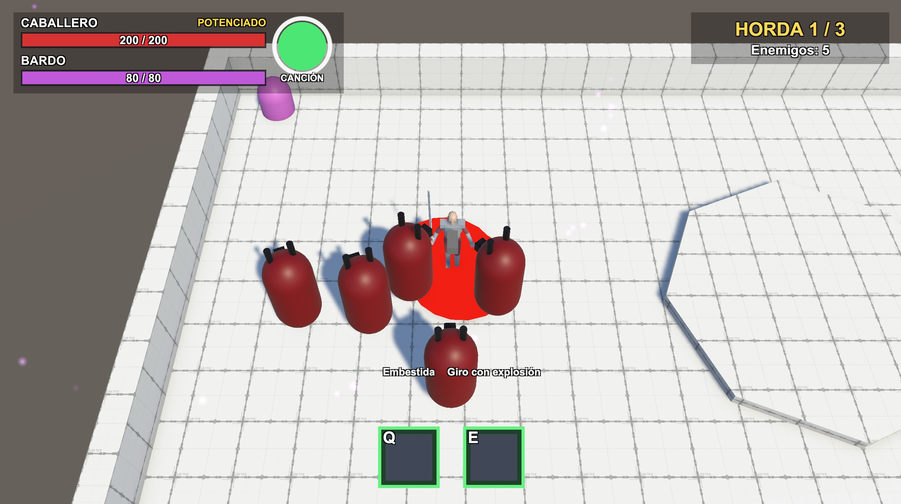
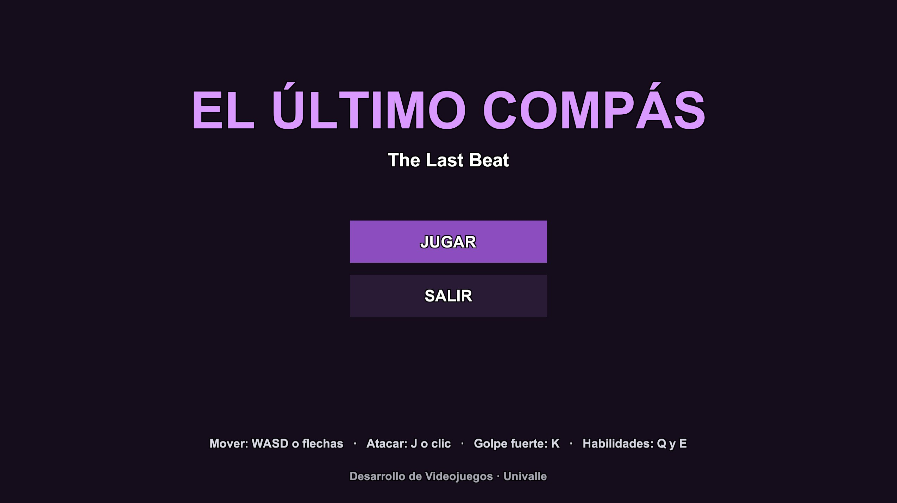
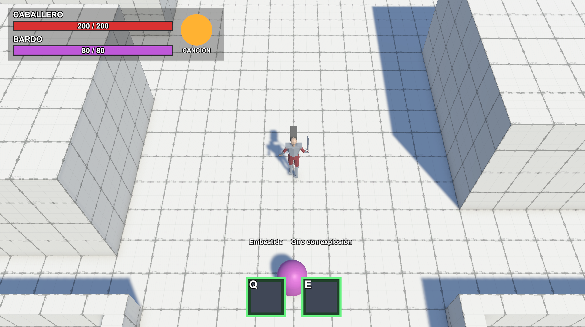
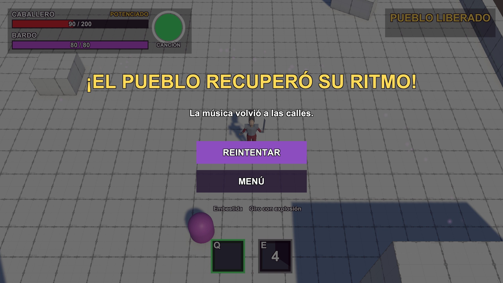

# The Last Beat (El Último Compás)

Juego de acción con cámara cenital en Unity: un caballero, una bardo cuya canción potencia a sus aliados,
y hordas de demonios en un pueblo corrupto. Proyecto de equipo de 3 personas con dos entregas, para el curso
Desarrollo de Videojuegos de la Universidad del Valle.



## Primera entrega (v0.1)

En este mundo la magia nace del ritmo, y el Rey Demonio quiere silenciarlo. En esta entrega se juega el tramo del
pueblo de principio a fin:

1. **Menú principal** con Jugar y Salir.
2. **El pueblo en silencio:** el caballero entra con la bardo detrás. Solo se oye el viento.
3. **La plaza:** al entrar, la bardo empieza a cantar (dembow en 8 bits) y salen **tres hordas** de soldados demonio.
   Mientras la canción suena, el caballero está potenciado: más daño, más área en las habilidades y a veces esquiva solo.
4. **La canción se corta** si un demonio golpea a la bardo: el grupo pierde la potenciación y la música pierde capas
   hasta que ella vuelve a cantar. Hay que mantener a los demonios lejos de ella.
5. **Final:** victoria al superar la última horda; derrota si cae el caballero o la bardo. Las dos pantallas tienen
   Reintentar y Menú.

| Parte | Qué hay |
|---|---|
| Caballero | Combo débil y fuerte, Embestida (Q) y Giro con explosión (E). Héroe provisional hecho en Blender. |
| Bardo | IA de compañera: sigue al caballero, huye de los demonios, canta y potencia. Cápsula provisional. |
| Soldado demonio | IA con estados (perseguir, atacar con aviso en el suelo, aturdido, muerto), prioriza a la bardo si la tiene cerca. Sale de un pool. Cápsula provisional. |
| Nivel | Pueblo con entrada, calle y plaza; tres hordas configurables en `ScriptableObjects/Waves/Hordas_Pueblo.asset`. |
| Interfaz | HUD con vidas, recargas y estado de la canción; mensajes del nivel, contador de hordas y pantallas de fin. |
| Audio | Canción de la bardo y música de combate por capas, ambiente del pueblo y efectos con variantes, todo original. |

## Capturas

| | |
|---|---|
|  |  |
| Menú principal. | El pueblo en silencio, antes de entrar a la plaza. |
|  |  |
| Una horda en la plaza con la canción sonando. | Pantalla de victoria. |

## Jugar sin Unity

1. Descarga `TheLastBeat-v0.1-windows.zip` de la sección [Releases](../../releases) del repositorio.
2. Descomprime la carpeta completa y abre `The Last Beat.exe` (Windows 10 u 11, 64 bits).

Como el ejecutable no está firmado, Windows puede mostrar un aviso azul la primera vez:
`Más información` y luego `Ejecutar de todas formas`.

## Controles

| Acción | Teclado y ratón | Mando |
|---|---|---|
| Mover | WASD o flechas | Stick izquierdo |
| Ataque débil (combo) | Clic izquierdo o `J` | Botón oeste (X en Xbox) |
| Ataque fuerte (combo) | `K` | Botón sur (A en Xbox) |
| Embestida | `Q` o clic derecho | Botón norte (Y en Xbox) |
| Giro con explosión | `E` | Botón este (B en Xbox) |

La bardo no se controla: se mueve, huye y canta sola. La acción Pausa (`Esc` o Start) existe en
`Assets/_Project/Input/GameControls.inputactions`, pero en esta entrega todavía no abre ningún menú.

## Requisitos

- **Unity 6000.3.28f1** (Unity 6.3), render pipeline **URP**.
- **Git** y **Git LFS** (los modelos, texturas y audio van por LFS).
- Una llave SSH asociada a tu cuenta de GitHub.

## Cómo empezar

```bash
git clone git@github.com:EvilandAoki/The-Last-Beat.git
cd The-Last-Beat
git lfs install
git lfs pull
```

Abre la carpeta con Unity Hub (**Add → Add project from disk**). Debe detectar la versión `6000.3.28f1` sola.
Si ves errores como `could not be imported because the format is unsupported`, falta `git lfs pull`.

Para jugar desde el editor abre `Assets/_Project/Scenes/MainMenu.unity` y dale Play. La escena del nivel es
`Assets/_Project/Scenes/Pueblo.unity`.

## Estructura

```
Assets/_Project/
  Scripts/
    Core/        capas (GameLayers), IRespawnable
    Combat/      Health, DamageInfo, KnockbackReceiver
    Player/      PlayerController, PlayerCombat, PlayerInputReader
    Abilities/   AbilityData y las habilidades del caballero
    Companions/  BardCompanion (IA) y SongBuff (canción)
    Buffs/       BuffReceiver y BuffEffect (la potenciación de la canción)
    Enemies/     EnemySoldier (IA del soldado), EnemyPool, HeroTargets
    Level/       WaveData y WaveSpawner (hordas), LevelFlow y ZoneTrigger (flujo del nivel)
    Audio/       SfxPlayer y GameSfx (efectos), MusicLayerController (música por capas), AmbiencePlayer
    UI/          GameHud (vida, recargas y canción), mensajes del nivel, pantallas de fin y menú principal
    VFX/         Vfx (pool de partículas) y VfxLibrary
    Debug/       herramientas de prueba (TheLastBeat.DebugTools)
    Editor/      menús de configuración (The Last Beat > ...)
  Scenes/        MainMenu.unity, Pueblo.unity (el nivel) y Test_Combo.unity (pruebas); cada nivel con su NavMesh
  Prefabs/       Heroes/ (Knight, Bardo)  Enemies/ (Soldado)  UI/ (Hud)
  ScriptableObjects/  Abilities/  Buffs/  Waves/ (Hordas_Pueblo)
  Art/{Models,ConceptArt}   Audio/{Music,SFX} y MainMixer   Input/
  VFX/           Prefabs/  Materials/  Textures/  Resources/ (VfxLibrary)
Tools/Blender/     genera el héroe provisional (build_hero.py)
Tools/Audio/       genera la música y los efectos (ver Tools/Audio/README.md)
Tools/Planeacion/  scripts que crean issues, hitos y tablero en GitHub
docs/              guías del equipo y capturas
```

Convención: una carpeta por área dentro de `Scripts/` y el namespace `TheLastBeat.<Área>`.
Guías según tu línea de trabajo:
- Enemigos, hordas, flujo del nivel y escena principal: [docs/INTEGRACION.md](docs/INTEGRACION.md).
- Modelos, animaciones, audio e iconos: [docs/ARTE_Y_AUDIO.md](docs/ARTE_Y_AUDIO.md).

Los menús **The Last Beat > Pueblo, Enemigos, Nivel, Audio y Menús** montan en las escenas las piezas de la
línea B (soldado, pool, hordas, flujo del nivel, audio, menú y pantallas de fin) y son seguros de repetir.
**Pueblo > 2. Revisión final de la escena** comprueba que todo esté enlazado.

## Capas físicas

Se resuelven por nombre desde `Assets/_Project/Scripts/Core/GameLayers.cs`. Deben coincidir con
**Project Settings → Tags and Layers**.

| Capa | Uso |
|---|---|
| `Ground` | Suelo y obstáculos que bloquean cargas, proyectiles y línea de visión |
| `Player` | El caballero (héroe controlado por el jugador) |
| `Ally` | Compañeros controlados por IA (bardo, etc.) |
| `Enemy` | Demonios |
| `Projectile` | Proyectiles. Se usa en lugar de la capa `Hitbox` que mencionaba la tarea 3 |

## Equipo y tablero

Las 71 tareas están como issues en GitHub, agrupadas en dos hitos (**Entrega 1** y **Entrega final**) y en el
tablero **El Último Compás** (pestaña *Projects* del repositorio). Cada persona tiene una línea de trabajo
con pocas dependencias entre sí.

| Línea | Persona | Alcance |
|---|---|---|
| A | `EvilandAoki` | Héroes y combate: caballero, habilidades, bardo, canción, VFX de habilidades, HUD y diálogos |
| B | `kev405` | Enemigos, nivel e integración: IA de demonios, hordas, flujo del nivel, escena principal, builds |
| C | `alejandro9481` | Arte, animación, audio y narrativa: Tripo3D, Mixamo, música y efectos, guion |

Filtra los issues por etiqueta `linea-A`, `linea-B` o `linea-C`. El flujo de trabajo está en
[CONTRIBUTING.md](CONTRIBUTING.md).

## Créditos

- **Equipo:** Sebastian Rey (`EvilandAoki`), Kevin Aristizabal (`kev405`) y Alejandro Villamil (`alejandro9481`).
- **Música, ambiente y efectos de sonido:** originales del equipo, sintetizados por código con `Tools/Audio/`. Detalle y
  licencias en [CREDITS.md](CREDITS.md).
- **Concept art:** imágenes generadas con IA a partir de los diseños del equipo, en `Art/ConceptArt`.
- **Héroe provisional:** generado con Blender por `Tools/Blender/build_hero.py`. La bardo y el soldado son cápsulas
  provisionales hasta que lleguen los modelos de Tripo3D y Mixamo (tareas 22 a 28).
- **Herramientas:** Unity 6 (URP, Input System, Cinemachine, AI Navigation, ProBuilder), Blender y Claude (Anthropic)
  como asistente de programación en la línea B.

## Regenerar la planeación

Solo en un repositorio nuevo y sin issues. Detalles en `Tools/Planeacion/crear-planeacion.sh`
(Linux/macOS) y `Tools/Planeacion/crear-planeacion.ps1` (Windows).
